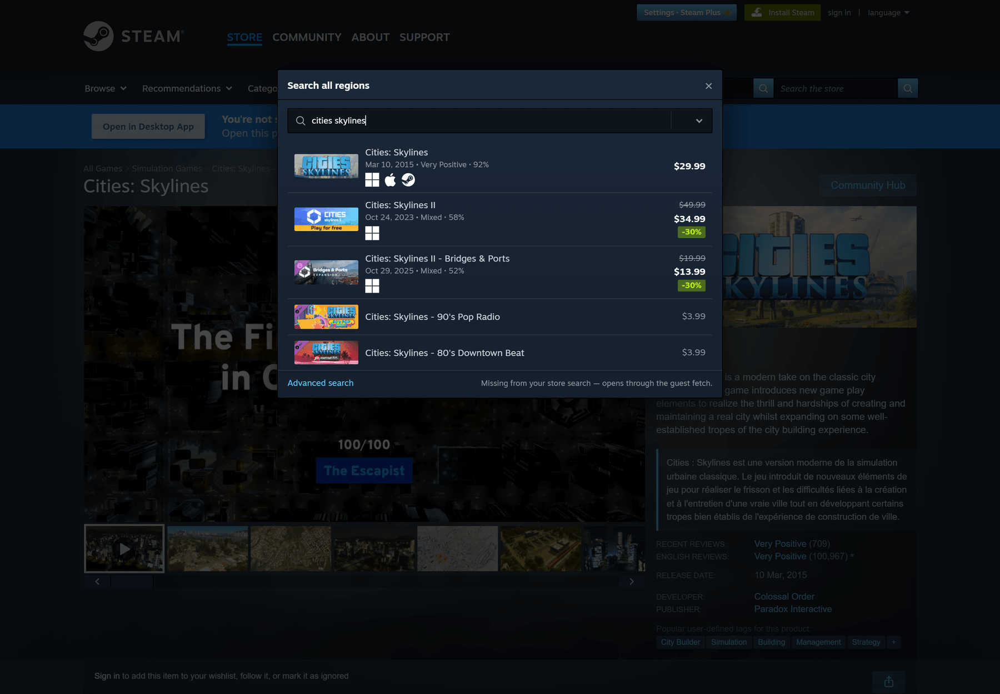

# Steam Plus

[](https://github.com/NemoKing1210/steam-plus/actions/workflows/ci.yml)
[](https://raw.githubusercontent.com/NemoKing1210/steam-plus/main/steam-plus.user.js)
[](https://github.com/NemoKing1210/steam-plus/blob/main/LICENSE)

[English](https://github.com/NemoKing1210/steam-plus/blob/main/README.md) · [Deutsch](https://github.com/NemoKing1210/steam-plus/blob/main/README.de.md) · [Русский](https://github.com/NemoKing1210/steam-plus/blob/main/README.ru.md) · **Español** · [Français](https://github.com/NemoKing1210/steam-plus/blob/main/README.fr.md) · [Português (Brasil)](https://github.com/NemoKing1210/steam-plus/blob/main/README.pt-BR.md) · [简体中文](https://github.com/NemoKing1210/steam-plus/blob/main/README.zh-CN.md) · [日本語](https://github.com/NemoKing1210/steam-plus/blob/main/README.ja.md) · [한국어](https://github.com/NemoKing1210/steam-plus/blob/main/README.ko.md) · [Polski](https://github.com/NemoKing1210/steam-plus/blob/main/README.pl.md)

Un userscript que mejora la tienda de Steam y la comunidad de Steam con un
panel de ajustes completo y traducción de contenido — descripciones de juegos,
reseñas, comentarios de perfil, noticias y guías — directamente en la página.

> **Estado:** fase temprana. Panel de ajustes (General · Traducción · Página
> del juego · Precios · Enlaces externos · DLC · Región) + traducción de
> contenido mediante el endpoint gratuito de Google (sin clave de API). Más
> mejoras de Steam en camino. La versión actual y los cambios están en la
> [CHANGELOG.md](https://github.com/NemoKing1210/steam-plus/blob/main/CHANGELOG.md).

> Los metadatos `@updateURL` / `@downloadURL` del script apuntan a `main` de
> GitHub: la URL de instalación directa de abajo siempre es la compilación más
> reciente.

## Capturas

El userscript real en una página de Steam en vivo. El idioma de destino de la
traducción es francés en las capturas.


| | |
|---|---|
| <br>**Traducción** — descripciones, reseñas, comentarios y noticias, debajo del original o sustituyéndolo | <br>**Precios regionales** — 24 regiones de la tienda, la más barata resaltada, conversión de divisas en tiempo real |
| <br>**Contenido adicional (DLC)** — todos los DLC con precio y fecha de lanzamiento; la propiedad aparece al iniciar sesión | <br>**Enlaces externos** — accesos rápidos a SteamDB, ProtonDB, HowLongToBeat y tus propios enlaces |
| <br>**Visor de imágenes** — amplía, desplaza, gira y navega por las ilustraciones de los DLC | <br>**Búsqueda rápida** — busca en la tienda entre regiones desde cualquier página |

También en las páginas de juego: oculta los bloques que nunca lees y recarga
páginas bloqueadas por región mediante una petición anónima de invitado.

## Instalación rápida

1. Instala un gestor de userscripts (se recomienda
   [Tampermonkey](https://www.tampermonkey.net/),
   [Violentmonkey](https://violentmonkey.github.io/) o
   [ScriptCat](https://scriptcat.org/)).
2. Instala el script desde GitHub (URL directa abajo).

**URL de instalación (GitHub — la más reciente):**

```
https://raw.githubusercontent.com/NemoKing1210/steam-plus/main/steam-plus.user.js
```

[](https://raw.githubusercontent.com/NemoKing1210/steam-plus/main/steam-plus.user.js)

### Instalación desde URL (panel del gestor)

| Gestor | Ruta |
|--------|------|
| Tampermonkey | Panel → **Utilidades** → **Instalar desde URL** |
| Violentmonkey | Panel → **+** → **Instalar desde URL** |
| Greasemonkey | Menú del complemento → **Nuevo script de usuario** → pega la URL directa |
| ScriptCat | Instala la [extensión](https://scriptcat.org/) y luego **Instalar desde URL** con la URL directa de GitHub |

Pega la URL de instalación de GitHub (arriba) al instalar desde el panel de un
gestor.

### Instalación manual

1. Abre el archivo compilado [`steam-plus.user.js`](https://github.com/NemoKing1210/steam-plus/blob/main/steam-plus.user.js) de este repositorio (o ejecuta `npm run build` tras clonarlo).
2. Copia todo el contenido del archivo.
3. En tu gestor de userscripts, crea un script nuevo y pega el código.
4. Guarda y activa el script.

## Actualizaciones

El script incluye los metadatos `@updateURL` y `@downloadURL` que apuntan al
archivo directo de GitHub. Los gestores compatibles comprueban las
actualizaciones automáticamente.

Pasos de publicación para mantenedores: consulta [docs/DEVELOPMENT.md § Releasing](https://github.com/NemoKing1210/steam-plus/blob/main/docs/DEVELOPMENT.md#releasing).

## Funciones

**Ajustes** (botón **Steam Plus** en la cabecera o menú del gestor de
userscripts):

- Panel con pestañas — **General** · **Traducción** · **Página del juego** ·
  **Precios** · **Enlaces externos** · **DLC** · **Región** (más pestañas en
  camino)
- Interfaz oscura al estilo de Steam; cada cambio se conserva tras recargar
- Idioma de la interfaz: Automático (navegador) o uno de **10 idiomas** —
  English, Русский, Deutsch, Español, Français, Português (Brasil), 简体中文,
  日本語, 한국어, Polski

**Traducción** (contenido de la tienda y la comunidad):

- **Descripciones de juegos** — la descripción completa en la página del juego
  y fragmentos en los listados
- **Reseñas de juegos** — reseñas de la tienda y tarjetas de reseña del hub de
  la comunidad
- **Comentarios de perfil** — hilos de comentarios en perfiles, hubs y archivos
  compartidos
- **Noticias y eventos** — el cuerpo de noticias/eventos y los resúmenes del hub
- **Guías** — un botón Traducir sobre la guía traduce todo el contenido a la
  vez: título, descripción superior y cada sección (los comentarios de las
  guías los cubre Comentarios de perfil)
- Endpoint gratuito de Google por defecto — sin clave de API, registro de
  proveedores ampliable
- Traduce **Automáticamente** cuando aparece el contenido o con un botón
  **Traducir** por bloque
- Muestra la traducción **debajo** del original o **sustituye** el texto con un
  botón para volver al original
- Idioma de destino: Automático (idioma de Steam / del navegador) o uno de 14
  idiomas habituales
- Interruptores por ámbito; interruptor maestro global

**Página del juego** (páginas de juego de la tienda):

- Oculta los bloques que nunca lees — capturas y tráileres, opciones de compra
  y paquetes, «Acerca de este juego», lista de DLC, requisitos del sistema,
  reseñas de usuarios, curadores, eventos y anuncios, barra lateral de
  detalles, franquicia y recomendaciones
- Interruptor maestro más interruptores por bloque; nada se oculta por defecto
- Ocultación solo con CSS que sobrevive a los re-renderizados de Steam y a la
  navegación

**Precios regionales** (páginas de juego de la tienda):

- Compara el precio del juego en 24 regiones de la tienda de Steam
  directamente en la página — tu precio fijado arriba, la región más barata
  resaltada y el ahorro respecto a tu precio
- Totalmente configurable: interruptores maestro y de carga automática,
  selector de regiones, posición (encima de las opciones de compra / barra
  lateral / debajo de la descripción), orden de filas por defecto con cabeceras
  clicables (un clic ordena, otro invierte la dirección) e interruptores de
  visualización por elemento (precio original, insignia de descuento, ahorro,
  resaltado del más barato, fila de tu precio)
- Precios con el formato propio de Steam, insignias de descuento en verde de
  Steam, caché de 1 hora con actualización manual; los juegos gratuitos ocultan
  el bloque automáticamente
- Conversión de divisas en vivo (ExchangeRate-API + respaldo jsDelivr, caché con
  duración configurable, estado y borrado manual en los ajustes): cada precio
  se convierte automáticamente a la moneda de tu tienda o a la que elijas, con
  la fuente de los tipos bajo el bloque

**Enlaces externos** (páginas de juego de la tienda):

- Accesos rápidos a otras tiendas y bases de datos en la página del juego —
  SteamDB, ProtonDB y HowLongToBeat por defecto —, colocados encima de las
  opciones de compra, en la barra lateral o debajo de la descripción
- Totalmente definido por el usuario: añade tus propios enlaces con plantillas
  de URL al estilo del navegador (`{name}` para el título del juego, `{appid}`
  para el id de Steam), favicons personalizados, interruptores por enlace,
  controles para reordenar y una opción para abrir en una pestaña nueva

**Contenido adicional (DLC)** (páginas de juego de la tienda):

- Lista **todos los DLC del juego** con su imagen de cápsula, fecha de
  lanzamiento, precio y si tu cuenta ya lo posee — un contador poseídos/total
  en la cabecera, enlaces por fila a la página de la tienda de cada DLC y orden
  «primero los no poseídos» para que lo que te falta quede arriba
- Empieza contraído para ahorrar espacio; expándelo con el chevron de la
  cabecera
- Haz clic en la imagen de un DLC para abrir el **visor de imágenes
  integrado**: ajuste a pantalla, zoom (rueda, `+`/`−`, doble clic), arrastrar
  para desplazar, girar, navegar por todos los DLC con `←`/`→` o la tira de
  miniaturas, `Esc` para cerrar; el visor es configurable (tira de miniaturas,
  bucle) y accesible por teclado
- Lee primero la lista de DLC de la página (nombres, precios, imágenes ya
  renderizadas) y pide a Steam solo lo que la página no ofrece — las fechas de
  lanzamiento y las cápsulas que Steam mantiene contraídas se rellenan
  progresivamente y se guardan un día en caché, la propiedad 30 minutos; con
  **Imágenes de los DLC** y **Fechas de lanzamiento** desactivados, una página
  cuyas filas Steam ya renderizó no cuesta ninguna petición; hay un reinicio de
  caché en la pestaña DLC
- Configurable: interruptor maestro, posición (encima de las opciones de compra
  / barra lateral / debajo de la descripción), orden de filas, contador de
  poseídos, filas poseídas, e interruptores de precio, imagen y fecha de
  lanzamiento

**Bypass de región** (páginas de tienda bloqueadas):

- Recarga las páginas `/app/`, `/bundle/` y `/sub/` bloqueadas con «no
  disponible en tu región» mediante una petición anónima de invitado — sin
  cookies de cuenta, con las cookies de idioma y control de edad de Steam
  enviadas automáticamente y un posible reemplazo del país de la tienda (`cc`)
- Inyecta el contenido de invitado en el documento activo — tu cabecera con
  sesión iniciada, estilos y scripts siguen intactos; las inicializaciones de
  invitado (reseñas, pestañas de requisitos, etiquetas) se reproducen y las
  islas de la tienda se hidratan en su sitio, con una reescritura completa del
  documento como respaldo automático; la traducción, los precios regionales,
  los enlaces externos, el contenido DLC y el ocultado de bloques se aplican
  automáticamente al contenido inyectado; el modo automático reemplaza el error
  al instante, el manual muestra primero un botón de oferta y los fallos
  muestran una tarjeta de estado con Reintentar
- Una pasarela HTTP opcional (host, puerto, autenticación básica, tres modos de
  URL) para bloqueos por IP — todo en la pestaña Región

Bajo el capó: una caché de traducciones por proveedor con TTL y recorte LRU más
una cola de peticiones con concurrencia limitada — rápida en visitas repetidas
y amable con el servicio de traducción.

> La traducción requiere conexión a internet con el proveedor
> (`translate.googleapis.com` para el proveedor por defecto). El contenido
> traducido se guarda en caché local en el almacenamiento del gestor de
> userscripts.

## Páginas compatibles

| Sitio | Patrón de URL |
|-------|---------------|
| Tienda de Steam | `https://store.steampowered.com/*` |
| Comunidad de Steam | `https://steamcommunity.com/*` |

## Desarrollo y contribución

- [docs/DEVELOPMENT.md](https://github.com/NemoKing1210/steam-plus/blob/main/docs/DEVELOPMENT.md) — compilación, pruebas locales, publicación
- [docs/ARCHITECTURE.md](https://github.com/NemoKing1210/steam-plus/blob/main/docs/ARCHITECTURE.md) — estructura de módulos, flujo de datos, contratos de extensión
- [CONTRIBUTING.md](https://github.com/NemoKing1210/steam-plus/blob/main/CONTRIBUTING.md) — pautas y convenciones para PR
- [SECURITY.md](https://github.com/NemoKing1210/steam-plus/blob/main/SECURITY.md) — cómo informar de una vulnerabilidad
- [AGENTS.md](https://github.com/NemoKing1210/steam-plus/blob/main/AGENTS.md) — notas de arquitectura para agentes de IA

```bash
npm install
npm run dev      # Servidor Vite — instala el userscript "dev:" generado
npm run build    # Producción → dist/ + copia a la raíz del repositorio
npm run ci       # Las mismas comprobaciones que en GitHub Actions
```

Requiere Node.js 22 (ver `.nvmrc`).

## Afiliación

Este proyecto **no está afiliado** con Valve ni Steam. Es un userscript
comunitario independiente.

## Licencia

[MIT](https://github.com/NemoKing1210/steam-plus/blob/main/LICENSE) — Copyright (c) 2026 NemoKing1210
