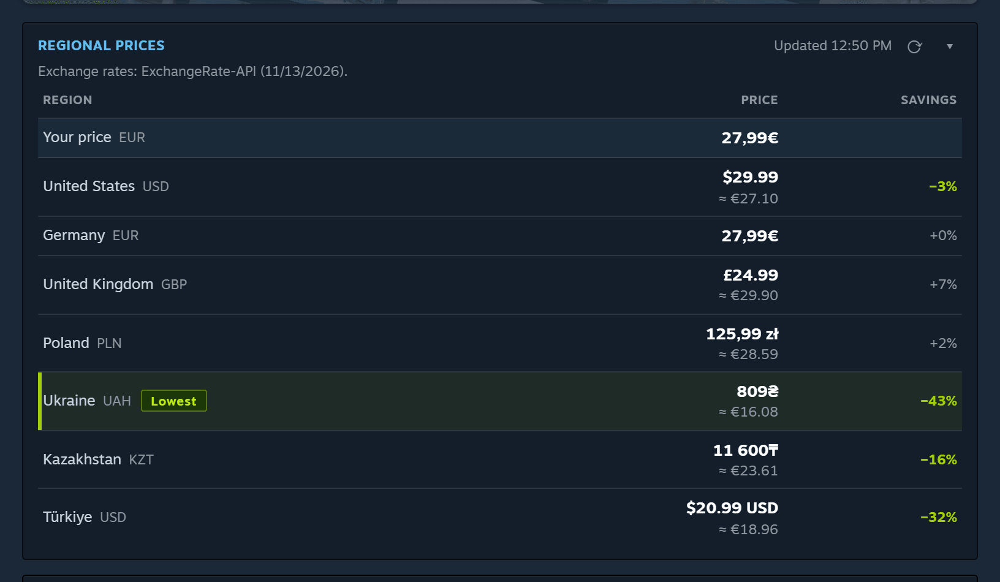

# Steam Plus

[](https://github.com/NemoKing1210/steam-plus/actions/workflows/ci.yml)
[](https://raw.githubusercontent.com/NemoKing1210/steam-plus/main/steam-plus.user.js)
[](https://github.com/NemoKing1210/steam-plus/blob/main/LICENSE)

[English](https://github.com/NemoKing1210/steam-plus/blob/main/README.md) · [Deutsch](https://github.com/NemoKing1210/steam-plus/blob/main/README.de.md) · [Русский](https://github.com/NemoKing1210/steam-plus/blob/main/README.ru.md) · [Español](https://github.com/NemoKing1210/steam-plus/blob/main/README.es.md) · **Français** · [Português (Brasil)](https://github.com/NemoKing1210/steam-plus/blob/main/README.pt-BR.md) · [简体中文](https://github.com/NemoKing1210/steam-plus/blob/main/README.zh-CN.md) · [日本語](https://github.com/NemoKing1210/steam-plus/blob/main/README.ja.md) · [한국어](https://github.com/NemoKing1210/steam-plus/blob/main/README.ko.md) · [Polski](https://github.com/NemoKing1210/steam-plus/blob/main/README.pl.md)

Un userscript qui améliore le Steam Store et la Steam Community avec un panneau
de réglages complet et la traduction du contenu — descriptions de jeux,
évaluations, commentaires de profil, actualités et guides — directement sur la
page.

> **Statut :** début de développement. Panneau de réglages (Général ·
> Traduction · Page du jeu · Prix · Liens externes · DLC · Région) + traduction
> du contenu via le point de terminaison Google gratuit (sans clé d'API).
> D'autres améliorations de Steam sont prévues. La version actuelle et les
> changements figurent dans la
> [CHANGELOG.md](https://github.com/NemoKing1210/steam-plus/blob/main/CHANGELOG.md).

> Les métadonnées `@updateURL` / `@downloadURL` du script pointent vers `main`
> sur GitHub — l'URL d'installation brute ci-dessous est toujours la version la
> plus récente.

## Captures d'écran

Le vrai userscript sur une page Steam en direct. La langue cible de la
traduction est le français sur les captures.


| | |
|---|---|
| <br>**Traduction** — descriptions, évaluations, commentaires et actualités, sous l'original ou à sa place | <br>**Prix régionaux** — 24 régions du store, la moins chère mise en évidence, conversion de devises en direct |
| <br>**Contenu additionnel** — tous les DLC avec prix et date de sortie ; la possession apparaît une fois connecté | <br>**Liens externes** — accès rapides à SteamDB, ProtonDB, HowLongToBeat et vos propres liens |
| <br>**Visionneuse d'images** — zoom, déplacement, rotation et navigation dans les visuels des DLC | <br>**Recherche rapide** — rechercher dans le store entre les régions depuis n'importe quelle page |

Également sur les pages de jeu : masquez les blocs que vous ne lisez jamais et
rechargez les pages de store bloquées par région via une requête invitée
anonyme.

## Installation rapide

1. Installez un gestionnaire de userscripts
   ([Tampermonkey](https://www.tampermonkey.net/),
   [Violentmonkey](https://violentmonkey.github.io/) ou
   [ScriptCat](https://scriptcat.org/) recommandé).
2. Installez le script depuis GitHub (URL brute ci-dessous).

**URL d'installation (GitHub — la plus récente) :**

```
https://raw.githubusercontent.com/NemoKing1210/steam-plus/main/steam-plus.user.js
```

[](https://raw.githubusercontent.com/NemoKing1210/steam-plus/main/steam-plus.user.js)

### Installation depuis une URL (tableau de bord)

| Gestionnaire | Chemin |
|--------------|--------|
| Tampermonkey | Tableau de bord → **Utilitaires** → **Installer depuis une URL** |
| Violentmonkey | Tableau de bord → **+** → **Installer depuis une URL** |
| Greasemonkey | Menu de l'extension → **Nouveau script utilisateur** → collez l'URL brute |
| ScriptCat | Installez l'[extension](https://scriptcat.org/), puis **Installer depuis une URL** avec l'URL brute GitHub |

Collez l'URL d'installation GitHub (ci-dessus) lors de l'installation depuis le
tableau de bord d'un gestionnaire.

### Installation manuelle

1. Ouvrez le fichier compilé [`steam-plus.user.js`](https://github.com/NemoKing1210/steam-plus/blob/main/steam-plus.user.js) de ce dépôt (ou lancez `npm run build` après avoir cloné).
2. Copiez tout le contenu du fichier.
3. Dans votre gestionnaire de userscripts, créez un nouveau script et collez le code.
4. Enregistrez et activez le script.

## Mises à jour

Le script inclut les métadonnées `@updateURL` et `@downloadURL` pointant vers le
fichier brut GitHub. Les gestionnaires compatibles vérifient automatiquement
les mises à jour.

Étapes de publication pour les mainteneurs : voir [docs/DEVELOPMENT.md § Releasing](https://github.com/NemoKing1210/steam-plus/blob/main/docs/DEVELOPMENT.md#releasing).

## Fonctionnalités

**Réglages** (bouton **Steam Plus** dans l'en-tête ou menu du gestionnaire de
userscripts) :

- Panneau à onglets — **Général** · **Traduction** · **Page du jeu** ·
  **Prix** · **Liens externes** · **DLC** · **Région** (d'autres onglets sont
  prévus)
- Interface sombre aux couleurs de Steam ; chaque changement est conservé après
  rechargement
- Langue de l'interface : Auto (navigateur) ou l'une des **10 langues** —
  English, Русский, Deutsch, Español, Français, Português (Brasil), 简体中文,
  日本語, 한국어, Polski

**Traduction** (contenu du store et de la communauté) :

- **Descriptions de jeux** — description complète sur la page du jeu et
  extraits dans les listes
- **Évaluations de jeux** — évaluations du store et cartes d'évaluation du hub
  communautaire
- **Commentaires de profil** — fils de commentaires sur les profils, hubs et
  fichiers partagés
- **Actualités et événements** — corps des actualités/événements et résumés du
  hub
- **Guides** — un bouton Traduire au-dessus du guide traduit tout le contenu
  d'un coup : titre, description du haut et chaque section (les commentaires
  des guides sont couverts par Commentaires de profil)
- Point de terminaison Google gratuit par défaut — aucune clé d'API, registre
  de fournisseurs extensible
- Traduisez **Automatiquement** à l'apparition du contenu ou via un bouton
  **Traduire** par bloc
- Affichez la traduction **sous** l'original ou **remplacez** le texte avec un
  bouton pour revenir à l'original
- Langue cible : Auto (langue de Steam / du navigateur) ou l'une des 14 langues
  courantes
- Interrupteurs par portée ; interrupteur principal global

**Page du jeu** (pages de jeu du store) :

- Masquez les blocs que vous ne lisez jamais — captures d'écran et
  bandes-annonces, options d'achat et packs, « À propos de ce jeu », liste des
  DLC, configuration requise, évaluations des utilisateurs, curateurs,
  événements et annonces, barre latérale des détails, franchise et
  recommandations
- Interrupteur principal plus interrupteurs par bloc ; rien n'est masqué par
  défaut
- Masquage en CSS pur qui résiste aux re-rendus de Steam et à la navigation

**Prix régionaux** (pages de jeu du store) :

- Comparez le prix du jeu dans 24 régions du store Steam directement sur la
  page du jeu — votre prix épinglé en haut, la région la moins chère mise en
  évidence, l'économie par rapport à votre prix affichée
- Entièrement configurable : interrupteurs principal et de chargement auto,
  sélecteur de régions, emplacement (au-dessus des options d'achat / barre
  latérale / sous la description), ordre des lignes par défaut avec en-têtes
  cliquables (un clic trie, un autre inverse le sens) et interrupteurs
  d'affichage par élément (prix d'origine, badge de réduction, économies, mise
  en évidence du moins cher, ligne de votre prix)
- Prix formatés par Steam, badges de réduction vert Steam, cache d'une heure
  avec actualisation manuelle ; les jeux gratuits masquent automatiquement le
  bloc
- Conversion de devises en direct (ExchangeRate-API + repli jsDelivr, cache à
  durée configurable, statut et effacement manuel dans les réglages) : chaque
  prix est converti automatiquement dans la devise de votre store ou celle
  choisie, la source des taux est indiquée sous le bloc

**Liens externes** (pages de jeu du store) :

- Accès rapides vers d'autres stores et bases de données sur la page du jeu —
  SteamDB, ProtonDB et HowLongToBeat par défaut — placés au-dessus des options
  d'achat, dans la barre latérale ou sous la description
- Entièrement personnalisable : ajoutez vos propres liens avec des modèles
  d'URL de type navigateur (`{name}` pour le titre du jeu, `{appid}` pour l'id
  Steam), des favicons personnalisés, des interrupteurs par lien, des contrôles
  de réorganisation et une option d'ouverture dans un nouvel onglet

**Contenu additionnel** (pages de jeu du store) :

- Liste **tous les DLC du jeu** avec leur image capsule, leur date de sortie,
  leur prix et si votre compte le possède déjà — un compteur possédés/total
  dans l'en-tête, des liens par ligne vers la page store de chaque DLC et un
  tri « non possédés d'abord » pour que ce qui vous manque reste en haut
- S'ouvre replié pour gagner de la place ; dépliez-le avec le chevron de
  l'en-tête
- Cliquez sur l'image d'un DLC pour ouvrir la **visionneuse d'images
  intégrée** : ajustement à l'écran, zoom (molette, `+`/`−`, double clic),
  glisser pour déplacer, rotation, navigation dans tous les DLC avec `←`/`→` ou
  la bande de miniatures, `Esc` pour fermer ; la visionneuse est configurable
  (bande de miniatures, boucle) et accessible au clavier
- Lit d'abord la liste des DLC de la page (noms, prix, images déjà rendues) et
  ne demande à Steam que ce que la page ne fournit pas — les dates de sortie et
  les capsules que Steam garde repliées se remplissent progressivement et sont
  mises en cache un jour, la possession 30 minutes ; en désactivant **Images
  des DLC** et **Dates de sortie**, une page dont Steam a déjà rendu les lignes
  ne coûte aucune requête ; une réinitialisation du cache se trouve dans
  l'onglet DLC
- Configurable : interrupteur principal, emplacement (au-dessus des options
  d'achat / barre latérale / sous la description), ordre des lignes, compteur
  de possession, lignes possédées, interrupteurs de prix, d'image et de date de
  sortie

**Contournement régional** (pages de store bloquées) :

- Recharge les pages `/app/`, `/bundle/` et `/sub/` bloquées par « non
  disponible dans votre région » via une requête invitée anonyme — sans cookies
  de compte, avec les cookies de langue et de contrôle d'âge de Steam envoyés
  automatiquement et un remplacement facultatif du pays du store (`cc`)
- Injecte le contenu invité dans le document actif — votre en-tête connecté,
  vos styles et scripts restent intacts ; les initialisations invitées
  (évaluations, onglets de configuration, tags) sont rejouées et les îlots du
  store s'hydratent sur place, avec une réécriture complète du document en
  repli automatique ; la traduction, les prix régionaux, les liens externes, le
  contenu DLC et le masquage des blocs s'appliquent automatiquement au contenu
  injecté ; le mode auto remplace l'erreur immédiatement, le mode manuel
  affiche d'abord un bouton d'offre, et les échecs affichent une carte d'état
  avec Réessayer
- Une passerelle proxy HTTP facultative (hôte, port, authentification basique,
  trois modes d'URL) pour les blocages par IP — le tout dans l'onglet Région

Sous le capot : un cache de traduction par fournisseur avec TTL et élagage LRU,
plus une file de requêtes à concurrence limitée — rapide lors des visites
répétées, doux avec le service de traduction.

> La traduction nécessite une connexion à internet vers le fournisseur
> (`translate.googleapis.com` pour le fournisseur par défaut). Le contenu
> traduit est mis en cache localement dans le stockage du gestionnaire de
> userscripts.

## Pages prises en charge

| Site | Modèle d'URL |
|------|--------------|
| Steam Store | `https://store.steampowered.com/*` |
| Steam Community | `https://steamcommunity.com/*` |

## Développement et contribution

- [docs/DEVELOPMENT.md](https://github.com/NemoKing1210/steam-plus/blob/main/docs/DEVELOPMENT.md) — compilation, tests locaux, publication
- [docs/ARCHITECTURE.md](https://github.com/NemoKing1210/steam-plus/blob/main/docs/ARCHITECTURE.md) — structure des modules, flux de données, contrats d'extension
- [CONTRIBUTING.md](https://github.com/NemoKing1210/steam-plus/blob/main/CONTRIBUTING.md) — consignes et conventions de PR
- [SECURITY.md](https://github.com/NemoKing1210/steam-plus/blob/main/SECURITY.md) — comment signaler une vulnérabilité
- [AGENTS.md](https://github.com/NemoKing1210/steam-plus/blob/main/AGENTS.md) — notes d'architecture pour les agents IA

```bash
npm install
npm run dev      # Serveur Vite — installez le userscript "dev:" généré
npm run build    # Production → dist/ + copie à la racine du dépôt
npm run ci       # Mêmes vérifications que GitHub Actions
```

Nécessite Node.js 22 (voir `.nvmrc`).

## Affiliation

Ce projet **n'est pas affilié** à Valve ni à Steam. C'est un userscript
communautaire indépendant.

## Licence

[MIT](https://github.com/NemoKing1210/steam-plus/blob/main/LICENSE) — Copyright (c) 2026 NemoKing1210
