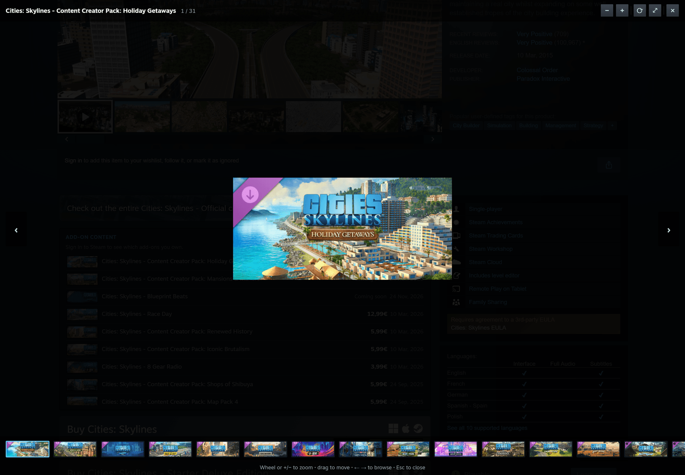

# Steam Plus

[](https://github.com/NemoKing1210/steam-plus/actions/workflows/ci.yml)
[](https://raw.githubusercontent.com/NemoKing1210/steam-plus/main/steam-plus.user.js)
[](https://github.com/NemoKing1210/steam-plus/blob/main/LICENSE)

[English](https://github.com/NemoKing1210/steam-plus/blob/main/README.md) · [Deutsch](https://github.com/NemoKing1210/steam-plus/blob/main/README.de.md) · [Русский](https://github.com/NemoKing1210/steam-plus/blob/main/README.ru.md) · [Español](https://github.com/NemoKing1210/steam-plus/blob/main/README.es.md) · [Français](https://github.com/NemoKing1210/steam-plus/blob/main/README.fr.md) · [Português (Brasil)](https://github.com/NemoKing1210/steam-plus/blob/main/README.pt-BR.md) · [简体中文](https://github.com/NemoKing1210/steam-plus/blob/main/README.zh-CN.md) · **日本語** · [한국어](https://github.com/NemoKing1210/steam-plus/blob/main/README.ko.md) · [Polski](https://github.com/NemoKing1210/steam-plus/blob/main/README.pl.md)

Steam ストアと Steam コミュニティを強化するユーザースクリプトです。充実した
設定パネルとコンテンツ翻訳（ゲーム説明、レビュー、プロフィールコメント、
ニュース、ガイド）をページ上で直接提供します。

> **ステータス:** 初期段階。設定パネル（一般 · 翻訳 · ゲームページ · 価格 ·
> 外部リンク · 追加コンテンツ · リージョン）+ 無料の Google
> エンドポイントによるコンテンツ翻訳（API キー不要）。さらなる Steam の改善を
> 予定しています。現在のバージョンと変更点は
> [CHANGELOG.md](https://github.com/NemoKing1210/steam-plus/blob/main/CHANGELOG.md)
> にあります。

> スクリプトの `@updateURL` / `@downloadURL` メタデータは GitHub の `main`
> を指しています。下の生 URL から常に最新ビルドをインストールできます。

## スクリーンショット

実際の Steam ページで動作する本物のユーザースクリプトです。スクリーンショット
では翻訳先をフランス語に設定しています。


| | |
|---|---|
| <br>**翻訳** — 説明、レビュー、コメント、ニュースを原文の下に表示、または原文を置き換え | <br>**地域別価格** — 24 のストアリージョン、最安値を強調、リアルタイムの為替換算 |
| <br>**追加コンテンツ** — すべての DLC の価格と発売日。サインインすると所有状況を表示 | <br>**外部リンク** — SteamDB、ProtonDB、HowLongToBeat、独自リンクへのクイックアクセス |
| <br>**画像ビューア** — DLC アートワークのズーム、パン、回転、閲覧 | <br>**クイック検索** — どのストアページからでもリージョンをまたいでストアを検索 |

ゲームページではほかにも、読まないブロックを非表示にし、リージョン制限された
ストアページを匿名のゲスト取得で再読み込みできます。

## クイックインストール

1. ユーザースクリプトマネージャーをインストールします
   （[Tampermonkey](https://www.tampermonkey.net/)、
   [Violentmonkey](https://violentmonkey.github.io/)、
   [ScriptCat](https://scriptcat.org/) を推奨）。
2. GitHub からスクリプトをインストールします（下の生 URL）。

**インストール URL（GitHub — 最新ビルド）:**

```
https://raw.githubusercontent.com/NemoKing1210/steam-plus/main/steam-plus.user.js
```

[](https://raw.githubusercontent.com/NemoKing1210/steam-plus/main/steam-plus.user.js)

### URL からインストール（ダッシュボード）

| マネージャー | 手順 |
|--------------|------|
| Tampermonkey | ダッシュボード → **ユーティリティ** → **URL からインストール** |
| Violentmonkey | ダッシュボード → **+** → **URL からインストール** |
| Greasemonkey | アドオンメニュー → **新しいユーザースクリプト** → 生 URL を貼り付け |
| ScriptCat | [拡張機能](https://scriptcat.org/)をインストールし、GitHub の生 URL で**URL からインストール** |

マネージャーのダッシュボードからインストールする場合は、上の GitHub
インストール URL を貼り付けてください。

### 手動インストール

1. このリポジトリのビルド済み [`steam-plus.user.js`](https://github.com/NemoKing1210/steam-plus/blob/main/steam-plus.user.js) を開きます（クローン後は `npm run build` を実行）。
2. ファイルの内容をすべてコピーします。
3. ユーザースクリプトマネージャーで新しいスクリプトを作成し、コードを貼り付けます。
4. 保存してスクリプトを有効にします。

## 更新

スクリプトには GitHub の生ファイルを指す `@updateURL` と `@downloadURL`
メタデータが含まれています。対応するマネージャーは自動的に更新を確認します。

メンテナー向けのリリース手順は [docs/DEVELOPMENT.md § Releasing](https://github.com/NemoKing1210/steam-plus/blob/main/docs/DEVELOPMENT.md#releasing) を参照してください。

## 機能

**設定**（ヘッダーの **Steam Plus** ボタン、またはユーザースクリプト
マネージャーのメニュー）:

- タブ式パネル — **一般** · **翻訳** · **ゲームページ** · **価格** ·
  **外部リンク** · **追加コンテンツ** · **リージョン**（タブは今後追加予定）
- Steam ネイティブのダーク UI。すべての変更は再読み込み後も保持されます
- 表示言語：自動（ブラウザー）または **10 言語**から選択 — English、
  Русский、Deutsch、Español、Français、Português (Brasil)、简体中文、日本語、
  한국어、Polski

**翻訳**（ストアとコミュニティのコンテンツ）:

- **ゲーム説明** — ゲームページの全文説明と一覧の抜粋
- **ゲームレビュー** — ストアのレビューとコミュニティハブのレビューカード
- **プロフィールコメント** — プロフィール、ハブ、共有ファイルのコメント
  スレッド
- **ニュースとイベント** — ニュース/イベント詳細の本文とハブの要約
- **ガイド** — ガイド上部の「翻訳」ボタンでタイトル、上部説明、各セクションを
  一度に翻訳します（ガイドのコメントはプロフィールコメントでカバー）
- デフォルトで無料の Google エンドポイント — API キー不要、プロバイダー
  レジストリは拡張可能
- コンテンツが表示されたら**自動**翻訳、またはブロックごとの**翻訳**ボタンで
  実行
- 翻訳を原文の**下**に表示、または原文を**置き換えて**ボタンで元に戻す
- 翻訳先言語：自動（Steam/ブラウザーの言語）または 14 の一般的な言語
- スコープごとのオン/オフスイッチ、グローバルなマスタースイッチ

**ゲームページ**（ストアのゲームページ）:

- 読まないブロックを非表示 — スクリーンショットとトレーラー、購入オプションと
  バンドル、「このゲームについて」、DLC リスト、システム要件、
  ユーザーレビュー、キュレーター、イベントとお知らせ、詳細サイドバー、
  フランチャイズとおすすめ
- マスタースイッチとブロックごとのスイッチ。デフォルトでは何も非表示になり
  ません
- Steam の再描画やページナビゲーションに耐える純粋な CSS による非表示

**地域別価格**（ストアのゲームページ）:

- ゲームページ上で 24 の Steam ストアリージョンの価格を比較 — 自分のストア
  価格を先頭に固定、最安リージョンを強調、自分の価格に対する節約額を表示
- 完全に設定可能：マスター/自動読み込みスイッチ、リージョン選択、配置
  （購入オプションの上 / サイドバー / 説明の下）、クリック可能なテーブル
  ヘッダーによる既定の行順（クリックで並べ替え、再クリックで方向を反転）、
  要素ごとの表示スイッチ（元の価格、割引バッジ、節約額、最安の強調、
  自分の価格行）
- Steam 自身の整形済み価格、Steam グリーンの割引バッジ、手動更新付きの
  1 時間キャッシュ。無料ゲームではブロックを自動的に非表示
- リアルタイムの為替換算（ExchangeRate-API + jsDelivr フォールバック、
  設定可能な有効期間のキャッシュ、設定でステータス表示と手動クリア）：各価格は
  自分のストア通貨または選択した通貨に自動換算され、レートの出典がブロックの
  下に表示されます

**外部リンク**（ストアのゲームページ）:

- ゲームページに他のストアやデータベースへのクイックチップを表示 — デフォルト
  で SteamDB、ProtonDB、HowLongToBeat。購入オプションの上、サイドバー、
  または説明の下に配置
- 完全にユーザー定義：ブラウザー風の URL テンプレート（`{name}` はゲーム
  タイトル、`{appid}` は Steam id）で独自リンクを追加、カスタムファビコン、
  リンクごとのスイッチ、並べ替えコントロール、新しいタブで開くオプション

**追加コンテンツ**（ストアのゲームページ）:

- **ゲームのすべての DLC** をカプセル画像、発売日、価格、アカウントが既に
  所有しているかとともに一覧表示 — ヘッダーに所有数/合計のカウンター、各行
  から各 DLC のストアページへのリンク、「未所有を先に」並べ替えで不足分を
  上部に表示
- スペースを節約するため折りたたんで開始。ヘッダーのシェブロンで展開
- DLC 画像をクリックすると**内蔵画像ビューア**が開きます：画面に合わせる、
  ズーム（ホイール、`+`/`−`、ダブルクリック）、ドラッグでパン、回転、`←`/`→`
  またはサムネイルストリップで全 DLC を閲覧、`Esc` で閉じる。ビューアは設定
  可能（サムネイルストリップ、ループ）でキーボード操作にも対応
- まずページ自身の DLC リスト（名前、価格、描画済み画像）を読み、ページに
  ないものだけを Steam に問い合わせます — Steam が折りたたんでいる発売日と
  カプセルは段階的に埋まり、1 日間キャッシュされます（所有状況は 30 分）。
  **DLC 画像**と**発売日**をオフにすると、Steam が既に行を描画したページは
  リクエストなしで済みます。キャッシュのリセットは追加コンテンツの設定タブに
  あります
- 設定可能：マスタースイッチ、配置（購入オプションの上 / サイドバー /
  説明の下）、行の順序、所有数カウンター、所有済み行、価格・画像・発売日の
  スイッチ

**リージョンバイパス**（ブロックされたストアページ）:

- 「お住まいの地域では利用できません」でブロックされた `/app/`、`/bundle/`、
  `/sub/` ページを匿名のゲスト取得で再読み込み — アカウント Cookie は送信
  せず、Steam の言語と年齢確認の Cookie を自動送信、任意でストアの国（`cc`）
  を上書き
- ゲストコンテンツを現在のドキュメントに注入 — ログイン済みのヘッダー、
  スタイル、スクリプトはそのまま。ゲストの初期化（レビュー、システム要件
  タブ、タグ）を再生し、ストアアイランドはその場でハイドレート、構造が
  一致しない場合はドキュメント全体の書き換えに自動でフォールバック。翻訳、
  地域別価格、外部リンク、DLC コンテンツ、ブロック非表示は注入された
  コンテンツに自動適用されます。自動モードは即座にエラーを置き換え、手動
  モードは先にオファーボタンを表示し、失敗時は「再試行」付きのステータス
  カードを表示
- IP ベースのロック向けに任意の HTTP プロキシゲートウェイ（ホスト、ポート、
  Basic 認証、3 つの URL モード）— すべてリージョン設定タブ内

仕組み：プロバイダーごとの TTL と LRU 整理付き翻訳キャッシュに加え、同時
実行数を制限したリクエストキュー — 再訪問は高速で、翻訳サービスにもやさしい
設計です。

> 翻訳には翻訳プロバイダーへのインターネット接続が必要です（デフォルト
> プロバイダーは `translate.googleapis.com`）。翻訳されたコンテンツは
> ユーザースクリプトのローカルストレージにキャッシュされます。

## 対応ページ

| サイト | URL パターン |
|--------|--------------|
| Steam ストア | `https://store.steampowered.com/*` |
| Steam コミュニティ | `https://steamcommunity.com/*` |

## 開発とコントリビュート

- [docs/DEVELOPMENT.md](https://github.com/NemoKing1210/steam-plus/blob/main/docs/DEVELOPMENT.md) — ビルド、ローカルテスト、リリース
- [docs/ARCHITECTURE.md](https://github.com/NemoKing1210/steam-plus/blob/main/docs/ARCHITECTURE.md) — モジュール構成、データフロー、拡張契約
- [CONTRIBUTING.md](https://github.com/NemoKing1210/steam-plus/blob/main/CONTRIBUTING.md) — PR ガイドラインと規約
- [SECURITY.md](https://github.com/NemoKing1210/steam-plus/blob/main/SECURITY.md) — 脆弱性の報告方法
- [AGENTS.md](https://github.com/NemoKing1210/steam-plus/blob/main/AGENTS.md) — AI コーディングエージェント向けアーキテクチャノート

```bash
npm install
npm run dev      # Vite サーバー — 生成された "dev:" ユーザースクリプトをインストール
npm run build    # 本番ビルド → dist/ + リポジトリルートへコピー
npm run ci       # GitHub Actions と同じチェック
```

Node.js 22 が必要です（`.nvmrc` を参照）。

## 提携について

このプロジェクトは Valve や Steam と**提携していません**。独立したコミュニティ
製ユーザースクリプトです。

## ライセンス

[MIT](https://github.com/NemoKing1210/steam-plus/blob/main/LICENSE) — Copyright (c) 2026 NemoKing1210
