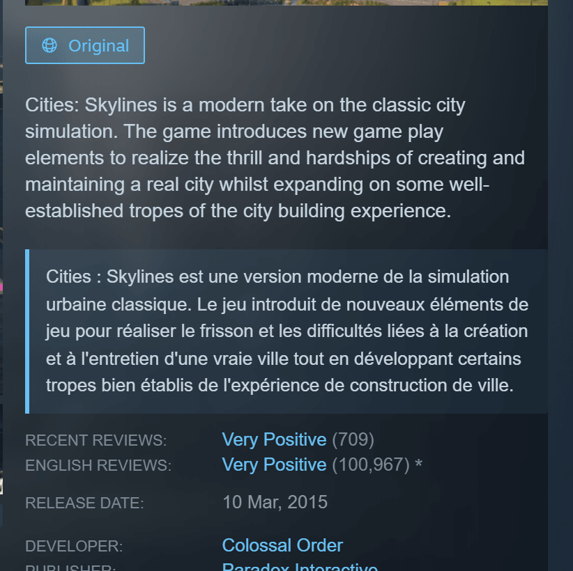

# Steam Plus

[](https://github.com/NemoKing1210/steam-plus/actions/workflows/ci.yml)
[](https://raw.githubusercontent.com/NemoKing1210/steam-plus/main/steam-plus.user.js)
[](https://github.com/NemoKing1210/steam-plus/blob/main/LICENSE)

[English](https://github.com/NemoKing1210/steam-plus/blob/main/README.md) · [Deutsch](https://github.com/NemoKing1210/steam-plus/blob/main/README.de.md) · [Русский](https://github.com/NemoKing1210/steam-plus/blob/main/README.ru.md) · [Español](https://github.com/NemoKing1210/steam-plus/blob/main/README.es.md) · [Français](https://github.com/NemoKing1210/steam-plus/blob/main/README.fr.md) · [Português (Brasil)](https://github.com/NemoKing1210/steam-plus/blob/main/README.pt-BR.md) · [简体中文](https://github.com/NemoKing1210/steam-plus/blob/main/README.zh-CN.md) · [日本語](https://github.com/NemoKing1210/steam-plus/blob/main/README.ja.md) · **한국어** · [Polski](https://github.com/NemoKing1210/steam-plus/blob/main/README.pl.md)

Steam 상점과 Steam 커뮤니티를 개선하는 유저스크립트입니다. 완전한 설정
패널과 콘텐츠 번역(게임 설명, 리뷰, 프로필 댓글, 뉴스, 가이드)을 페이지에서
바로 제공합니다.

> **상태:** 초기 단계. 설정 패널(일반 · 번역 · 게임 페이지 · 가격 · 외부 링크 ·
> 추가 콘텐츠 · 지역) + 무료 Google 엔드포인트를 통한 콘텐츠 번역(API 키 불필요).
> 더 많은 Steam 개선 사항이 예정되어 있습니다. 현재 버전과 변경 사항은
> [CHANGELOG.md](https://github.com/NemoKing1210/steam-plus/blob/main/CHANGELOG.md)에
> 있습니다.

> 스크립트의 `@updateURL` / `@downloadURL` 메타데이터는 GitHub `main`을
> 가리킵니다. 아래 원본 설치 URL은 항상 최신 빌드입니다.

## 스크린샷

실제 Steam 페이지에서 실행 중인 유저스크립트입니다. 스크린샷의 번역 대상
언어는 프랑스어입니다.


| | |
|---|---|
| <br>**번역** — 설명, 리뷰, 댓글, 뉴스를 원문 아래에 표시하거나 원문을 대체 | <br>**지역별 가격** — 24개 상점 지역, 최저가 강조, 실시간 환율 변환 |
| <br>**추가 콘텐츠** — 모든 DLC의 가격과 출시일; 로그인하면 보유 여부 표시 | <br>**외부 링크** — SteamDB, ProtonDB, HowLongToBeat 및 사용자 지정 링크로 빠른 이동 |
| <br>**이미지 뷰어** — DLC 아트워크 확대, 이동, 회전 및 탐색 | <br>**빠른 검색** — 모든 상점 페이지에서 지역을 넘나들며 상점 검색 |

게임 페이지에서는 읽지 않는 블록을 숨기고, 지역 제한된 상점 페이지를 익명
게스트 요청으로 다시 불러올 수도 있습니다.

## 빠른 설치

1. 유저스크립트 관리자를 설치합니다
   ([Tampermonkey](https://www.tampermonkey.net/),
   [Violentmonkey](https://violentmonkey.github.io/),
   [ScriptCat](https://scriptcat.org/) 권장).
2. GitHub에서 스크립트를 설치합니다(아래 원본 URL).

**설치 URL(GitHub — 최신 빌드):**

```
https://raw.githubusercontent.com/NemoKing1210/steam-plus/main/steam-plus.user.js
```

[](https://raw.githubusercontent.com/NemoKing1210/steam-plus/main/steam-plus.user.js)

### URL에서 설치(관리자 대시보드)

| 관리자 | 경로 |
|--------|------|
| Tampermonkey | 대시보드 → **유틸리티** → **URL에서 설치** |
| Violentmonkey | 대시보드 → **+** → **URL에서 설치** |
| Greasemonkey | 애드온 메뉴 → **새 사용자 스크립트** → 원본 URL 붙여넣기 |
| ScriptCat | [확장 프로그램](https://scriptcat.org/)을 설치한 뒤 GitHub 원본 URL로 **URL에서 설치** |

관리자 대시보드에서 설치할 때 위의 GitHub 설치 URL을 붙여넣으세요.

### 수동 설치

1. 이 저장소의 빌드된 [`steam-plus.user.js`](https://github.com/NemoKing1210/steam-plus/blob/main/steam-plus.user.js)를 엽니다(클론 후 `npm run build` 실행).
2. 파일 내용 전체를 복사합니다.
3. 유저스크립트 관리자에서 새 스크립트를 만들고 코드를 붙여넣습니다.
4. 저장하고 스크립트를 활성화합니다.

## 업데이트

스크립트에는 GitHub 원본 파일을 가리키는 `@updateURL` 및 `@downloadURL`
메타데이터가 포함되어 있습니다. 지원되는 관리자는 업데이트를 자동으로
확인합니다.

유지관리자용 릴리스 단계: [docs/DEVELOPMENT.md § Releasing](https://github.com/NemoKing1210/steam-plus/blob/main/docs/DEVELOPMENT.md#releasing) 참고.

## 기능

**설정**(헤더의 **Steam Plus** 버튼 또는 유저스크립트 관리자 메뉴):

- 탭 패널 — **일반** · **번역** · **게임 페이지** · **가격** · **외부 링크** ·
  **추가 콘텐츠** · **지역**(더 많은 탭 예정)
- Steam 네이티브 다크 UI; 모든 변경 사항은 새로고침 후에도 유지됩니다
- 인터페이스 언어: 자동(브라우저) 또는 **10개 언어** 중 하나 — English,
  Русский, Deutsch, Español, Français, Português (Brasil), 简体中文, 日本語,
  한국어, Polski

**번역**(상점 및 커뮤니티 콘텐츠):

- **게임 설명** — 게임 페이지의 전체 설명과 목록의 요약
- **게임 리뷰** — 상점 리뷰와 커뮤니티 허브 리뷰 카드
- **프로필 댓글** — 프로필, 허브, 공유 파일의 댓글 스레드
- **뉴스 및 이벤트** — 뉴스/이벤트 상세 본문과 허브 요약
- **가이드** — 가이드 위의 번역 버튼 하나로 제목, 상단 설명, 모든 섹션을 한
  번에 번역합니다(가이드 댓글은 프로필 댓글이 담당)
- 기본적으로 무료 Google 엔드포인트 사용 — API 키 불필요, 확장 가능한 공급자
  레지스트리
- 콘텐츠가 나타날 때 **자동** 번역하거나 블록별 **번역** 버튼으로 실행
- 번역을 원문 **아래**에 표시하거나 원문을 **대체**하고 버튼으로 되돌리기
- 대상 언어: 자동(Steam/브라우저 언어) 또는 14개 주요 언어 중 하나
- 범위별 켜기/끄기 스위치; 전역 마스터 스위치

**게임 페이지**(상점 게임 페이지):

- 읽지 않는 블록 숨기기 — 스크린샷 및 트레일러, 구매 옵션 및 번들, "이 게임
  정보", DLC 목록, 시스템 요구 사항, 사용자 리뷰, 큐레이터, 이벤트 및 공지,
  세부 정보 사이드바, 프랜차이즈 및 추천
- 마스터 스위치와 블록별 스위치; 기본적으로 아무것도 숨기지 않습니다
- Steam 재렌더링과 페이지 탐색에도 유지되는 순수 CSS 숨김

**지역별 가격**(상점 게임 페이지):

- 게임 페이지에서 24개 Steam 상점 지역의 가격을 비교 — 내 상점 가격은 맨 위에
  고정, 최저가 지역 강조, 내 가격 대비 절약액 표시
- 완전히 구성 가능: 마스터 및 자동 로드 스위치, 지역 선택, 배치(구매 옵션 위 /
  사이드바 / 설명 아래), 클릭 가능한 표 헤더가 있는 기본 행 순서(클릭하면
  정렬, 다시 클릭하면 방향 반전), 요소별 표시 스위치(원래 가격, 할인 배지,
  절약액, 최저가 강조, 내 가격 행)
- Steam 자체의 형식화된 가격, Steam 그린 할인 배지, 수동 새로고침이 가능한
  1시간 캐시; 무료 게임은 블록을 자동으로 숨깁니다
- 실시간 환율 변환(ExchangeRate-API + jsDelivr 대체, 구성 가능한 수명의 캐시,
  설정에서 상태 확인 및 수동 초기화): 모든 가격은 내 상점 통화 또는 선택한
  통화로 자동 변환되며 환율 출처가 블록 아래에 표시됩니다

**외부 링크**(상점 게임 페이지):

- 게임 페이지에 다른 상점 및 데이터베이스로 가는 빠른 칩 — 기본적으로 SteamDB,
  ProtonDB, HowLongToBeat — 구매 옵션 위, 사이드바 또는 설명 아래에 배치
- 완전한 사용자 정의: 브라우저 스타일 URL 템플릿(`{name}`은 게임 제목,
  `{appid}`는 Steam id)으로 고유 링크 추가, 사용자 지정 파비콘, 링크별 스위치,
  순서 변경 컨트롤, 새 탭에서 열기 옵션

**추가 콘텐츠**(상점 게임 페이지):

- **게임의 모든 DLC**를 캡슐 이미지, 출시일, 가격, 계정 보유 여부와 함께
  표시 — 헤더에 보유/전체 카운터, 각 DLC 상점 페이지로 가는 행별 링크, 부족한
  항목이 위에 남도록 "미보유 우선" 정렬
- 공간을 절약하기 위해 접힌 상태로 시작; 헤더의 화살표로 펼치기
- DLC 이미지를 클릭하면 **내장 이미지 뷰어**가 열립니다: 화면에 맞춤,
  확대/축소(휠, `+`/`−`, 더블 클릭), 드래그로 이동, 회전, `←`/`→` 또는
  썸네일 스트립으로 모든 DLC 탐색, `Esc`로 닫기; 뷰어는 구성 가능(썸네일
  스트립, 순환)하며 키보드로 조작할 수 있습니다
- 먼저 페이지 자체의 DLC 목록(이름, 가격, 렌더링된 이미지)을 읽고 페이지에
  없는 것만 Steam에 요청합니다 — Steam이 접어서 유지하는 출시일과 캡슐은
  점진적으로 채워지고 하루 동안 캐시되며, 보유 정보는 30분 동안 캐시됩니다.
  **DLC 이미지**와 **출시일**을 끄면 Steam이 이미 행을 렌더링한 페이지는
  요청이 전혀 들지 않습니다. 캐시 초기화는 추가 콘텐츠 설정 탭에 있습니다
- 구성 가능: 마스터 스위치, 배치(구매 옵션 위 / 사이드바 / 설명 아래), 행
  순서, 보유 카운터, 보유 행, 가격·이미지·출시일 스위치

**지역 차단 우회**(차단된 상점 페이지):

- "해당 지역에서 이용할 수 없음"으로 차단된 `/app/`, `/bundle/`, `/sub/`
  페이지를 익명 게스트 요청으로 다시 불러옵니다 — 계정 쿠키는 보내지 않고
  Steam 언어 및 연령 확인 쿠키는 자동으로 전송, 선택적으로 상점 국가(`cc`)
  재정의
- 게스트 콘텐츠를 현재 문서에 주입 — 로그인된 헤더, 스타일, 스크립트는 그대로
  유지됩니다. 게스트 초기화(리뷰, 시스템 요구 사항 탭, 태그)를 재생하고 상점
  아일랜드는 제자리에서 하이드레이션되며, 구조가 맞지 않으면 문서 전체 다시
  쓰기로 자동 대체됩니다. 번역, 지역별 가격, 외부 링크, DLC 콘텐츠, 블록
  숨김이 주입된 콘텐츠에 자동으로 적용됩니다. 자동 모드는 오류를 즉시
  대체하고, 수동 모드는 먼저 제안 버튼을 보여 주며, 실패 시 "다시 시도"가
  있는 상태 카드가 표시됩니다
- IP 기반 차단을 위한 선택적 HTTP 프록시 게이트웨이(호스트, 포트, 기본 인증,
  세 가지 URL 모드) — 모두 지역 설정 탭에 있습니다

내부 동작: 공급자별 TTL 및 LRU 정리가 있는 번역 캐시와 동시 실행이 제한된
요청 큐 — 반복 방문은 빠르고 번역 서비스에는 부담이 적습니다.

> 번역에는 번역 공급자와의 인터넷 연결이 필요합니다(기본 공급자는
> `translate.googleapis.com`). 번역된 콘텐츠는 유저스크립트 로컬 저장소에
> 캐시됩니다.

## 지원 페이지

| 사이트 | URL 패턴 |
|--------|----------|
| Steam 상점 | `https://store.steampowered.com/*` |
| Steam 커뮤니티 | `https://steamcommunity.com/*` |

## 개발 및 기여

- [docs/DEVELOPMENT.md](https://github.com/NemoKing1210/steam-plus/blob/main/docs/DEVELOPMENT.md) — 빌드, 로컬 테스트, 릴리스
- [docs/ARCHITECTURE.md](https://github.com/NemoKing1210/steam-plus/blob/main/docs/ARCHITECTURE.md) — 모듈 구조, 데이터 흐름, 확장 계약
- [CONTRIBUTING.md](https://github.com/NemoKing1210/steam-plus/blob/main/CONTRIBUTING.md) — PR 지침 및 규칙
- [SECURITY.md](https://github.com/NemoKing1210/steam-plus/blob/main/SECURITY.md) — 취약점 보고 방법
- [AGENTS.md](https://github.com/NemoKing1210/steam-plus/blob/main/AGENTS.md) — AI 코딩 에이전트를 위한 아키텍처 노트

```bash
npm install
npm run dev      # Vite 서버 — 생성된 "dev:" 유저스크립트 설치
npm run build    # 프로덕션 → dist/ + 저장소 루트로 복사
npm run ci       # GitHub Actions와 동일한 검사
```

Node.js 22 필요(`.nvmrc` 참고).

## 제휴

이 프로젝트는 Valve 또는 Steam과 **제휴하지 않습니다.** 독립적인 커뮤니티
유저스크립트입니다.

## 라이선스

[MIT](https://github.com/NemoKing1210/steam-plus/blob/main/LICENSE) — Copyright (c) 2026 NemoKing1210
