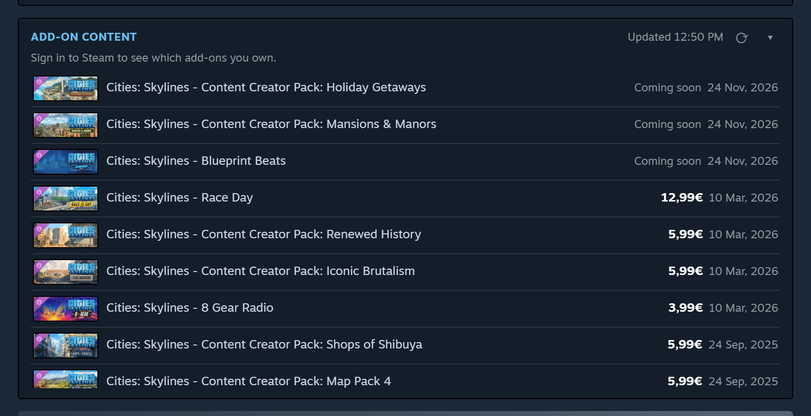
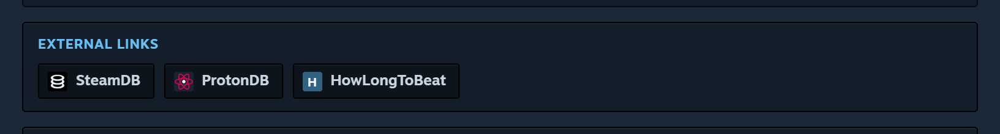

# Steam Plus

[](https://github.com/NemoKing1210/steam-plus/actions/workflows/ci.yml)
[](https://raw.githubusercontent.com/NemoKing1210/steam-plus/main/steam-plus.user.js)
[](https://github.com/NemoKing1210/steam-plus/blob/main/LICENSE)

[English](https://github.com/NemoKing1210/steam-plus/blob/main/README.md) · [Deutsch](https://github.com/NemoKing1210/steam-plus/blob/main/README.de.md) · [Русский](https://github.com/NemoKing1210/steam-plus/blob/main/README.ru.md) · [Español](https://github.com/NemoKing1210/steam-plus/blob/main/README.es.md) · [Français](https://github.com/NemoKing1210/steam-plus/blob/main/README.fr.md) · [Português (Brasil)](https://github.com/NemoKing1210/steam-plus/blob/main/README.pt-BR.md) · [简体中文](https://github.com/NemoKing1210/steam-plus/blob/main/README.zh-CN.md) · [日本語](https://github.com/NemoKing1210/steam-plus/blob/main/README.ja.md) · [한국어](https://github.com/NemoKing1210/steam-plus/blob/main/README.ko.md) · **Polski**

Skrypt użytkownika, który ulepsza Steam Store i Steam Community: pełny panel
ustawień i tłumaczenie treści — opisy gier, recenzje, komentarze profilowe,
aktualności i poradniki — bezpośrednio na stronie.

> **Status:** wczesna faza. Panel ustawień (Ogólne · Tłumaczenie · Strona gry ·
> Ceny · Linki zewnętrzne · Dodatki · Region) + tłumaczenie treści przez darmowy
> punkt końcowy Google (bez klucza API). Planowane są kolejne ulepszenia Steam.
> Aktualna wersja i zmiany:
> [CHANGELOG.md](https://github.com/NemoKing1210/steam-plus/blob/main/CHANGELOG.md).

> Metadane `@updateURL` / `@downloadURL` skryptu wskazują na `main` w GitHubie —
> surowy adres instalacyjny poniżej zawsze zawiera najnowszą kompilację.

## Zrzuty ekranu

Prawdziwy skrypt działający na stronie Steam. Językiem docelowym tłumaczenia na
zrzutach jest francuski.


| | |
|---|---|
| <br>**Tłumaczenie** — opisy, recenzje, komentarze i aktualności, pod oryginałem lub zamiast niego | <br>**Ceny regionalne** — 24 regiony sklepu, najtańszy wyróżniony, przeliczenie walut na żywo |
| <br>**Zawartość dodatkowa** — każdy dodatek z ceną i datą wydania; po zalogowaniu widać posiadanie | <br>**Linki zewnętrzne** — szybkie odnośniki do SteamDB, ProtonDB, HowLongToBeat i własnych linków |
| <br>**Przeglądarka obrazów** — powiększanie, przesuwanie, obracanie i przeglądanie grafik dodatków | <br>**Szybkie wyszukiwanie** — wyszukiwanie w sklepie między regionami z dowolnej strony sklepu |

Dodatkowo na stronach gier: ukrywanie bloków, których nigdy nie czytasz, oraz
ponowne ładowanie stron zablokowanych regionalnie przez anonimowe zapytanie
gościa.

## Szybka instalacja

1. Zainstaluj menedżer skryptów użytkownika (zalecane
   [Tampermonkey](https://www.tampermonkey.net/),
   [Violentmonkey](https://violentmonkey.github.io/) lub
   [ScriptCat](https://scriptcat.org/)).
2. Zainstaluj skrypt z GitHuba (surowy adres poniżej).

**Adres instalacyjny (GitHub — najnowsza kompilacja):**

```
https://raw.githubusercontent.com/NemoKing1210/steam-plus/main/steam-plus.user.js
```

[](https://raw.githubusercontent.com/NemoKing1210/steam-plus/main/steam-plus.user.js)

### Instalacja z adresu URL (panel menedżera)

| Menedżer | Ścieżka |
|----------|---------|
| Tampermonkey | Panel → **Narzędzia** → **Zainstaluj z URL** |
| Violentmonkey | Panel → **+** → **Zainstaluj z URL** |
| Greasemonkey | Menu dodatku → **Nowy skrypt użytkownika** → wklej surowy adres |
| ScriptCat | Zainstaluj [rozszerzenie](https://scriptcat.org/), a następnie **Zainstaluj z URL** z surowym adresem GitHuba |

Przy instalacji z panelu menedżera wklej adres instalacyjny GitHuba (powyżej).

### Instalacja ręczna

1. Otwórz skompilowany plik [`steam-plus.user.js`](https://github.com/NemoKing1210/steam-plus/blob/main/steam-plus.user.js) w tym repozytorium (lub uruchom `npm run build` po sklonowaniu).
2. Skopiuj całą zawartość pliku.
3. W menedżerze skryptów utwórz nowy skrypt i wklej kod.
4. Zapisz i włącz skrypt.

## Aktualizacje

Skrypt zawiera metadane `@updateURL` i `@downloadURL` wskazujące na surowy plik
GitHuba. Obsługiwane menedżery automatycznie sprawdzają aktualizacje.

Kroki wydania dla opiekunów: patrz [docs/DEVELOPMENT.md § Releasing](https://github.com/NemoKing1210/steam-plus/blob/main/docs/DEVELOPMENT.md#releasing).

## Funkcje

**Ustawienia** (przycisk **Steam Plus** w nagłówku lub menu menedżera skryptów):

- Panel z zakładkami — **Ogólne** · **Tłumaczenie** · **Strona gry** · **Ceny** ·
  **Linki zewnętrzne** · **Dodatki** · **Region** (kolejne zakładki planowane)
- Ciemny interfejs w stylu Steam; każda zmiana jest zachowywana po odświeżeniu
- Język interfejsu: Automatyczny (przeglądarka) lub jeden z **10 języków** —
  English, Русский, Deutsch, Español, Français, Português (Brasil), 简体中文,
  日本語, 한국어, Polski

**Tłumaczenie** (treści sklepu i społeczności):

- **Opisy gier** — pełny opis na stronie gry i fragmenty na listach
- **Recenzje gier** — recenzje sklepu i karty recenzji w centrum społeczności
- **Komentarze profilowe** — wątki komentarzy na profilach, w centrach i
  współdzielonych plikach
- **Aktualności i wydarzenia** — treść szczegółów aktualności/wydarzeń i
  podsumowania centrum
- **Poradniki** — jeden przycisk Tłumacz nad poradnikiem tłumaczy całość naraz:
  tytuł, górny opis i każdą sekcję (komentarze poradników obsługują Komentarze
  profilowe)
- Domyślnie darmowy punkt końcowy Google — bez klucza API, rozszerzalny rejestr
  dostawców
- Tłumaczenie **automatycznie** po pojawieniu się treści lub przyciskiem
  **Tłumacz** dla każdego bloku
- Pokazuj tłumaczenie **pod** oryginałem lub **zastępuj** tekst z przyciskiem
  powrotu do oryginału
- Język docelowy: Automatyczny (język Steam / przeglądarki) lub jeden z 14
  popularnych języków
- Przełączniki dla każdego zakresu; globalny przełącznik główny

**Strona gry** (strony gier w sklepie):

- Ukrywaj bloki, których nigdy nie czytasz — zrzuty ekranu i zwiastuny, opcje
  zakupu i pakiety, „O tej grze”, listę dodatków, wymagania systemowe, recenzje
  użytkowników, kuratorów, wydarzenia i ogłoszenia, pasek szczegółów, serię i
  rekomendacje
- Przełącznik główny i przełączniki dla bloków; domyślnie nic nie jest ukryte
- Ukrywanie czystym CSS, odporne na ponowne renderowanie Steam i nawigację

**Ceny regionalne** (strony gier w sklepie):

- Porównuj cenę gry w 24 regionach sklepu Steam bezpośrednio na stronie gry —
  twoja cena przypięta na górze, najtańszy region wyróżniony, oszczędność
  względem twojej ceny pokazana
- Pełna konfiguracja: przełączniki główny i automatycznego ładowania, wybór
  regionów, umiejscowienie (nad opcjami zakupu / pasek boczny / pod opisem),
  domyślna kolejność wierszy z klikalnymi nagłówkami tabeli (kliknięcie sortuje,
  ponowne odwraca kierunek) i przełączniki wyświetlania poszczególnych elementów
  (cena pierwotna, plakietka rabatu, oszczędność, wyróżnienie najtańszego, wiersz
  twojej ceny)
- Ceny formatowane przez Steam, zielone plakietki rabatu Steam, 1-godzinny cache
  z ręcznym odświeżaniem; darmowe gry automatycznie ukrywają blok
- Przeliczanie walut na żywo (ExchangeRate-API + fallback jsDelivr, cache z
  konfigurowalnym czasem życia, status i ręczne czyszczenie w ustawieniach):
  każda cena jest automatycznie przeliczana na walutę twojego sklepu lub wybraną,
  a źródło kursów jest podane pod blokiem

**Linki zewnętrzne** (strony gier w sklepie):

- Szybkie odnośniki do innych sklepów i baz danych na stronie gry — domyślnie
  SteamDB, ProtonDB i HowLongToBeat — umieszczane nad opcjami zakupu, na pasku
  bocznym lub pod opisem
- W pełni konfigurowalne: dodawaj własne linki z szablonami URL w stylu
  przeglądarki (`{name}` to tytuł gry, `{appid}` to identyfikator Steam), własne
  favikony, przełączniki dla linków, kontrolki zmiany kolejności i opcja
  otwierania w nowej karcie

**Zawartość dodatkowa** (strony gier w sklepie):

- Wyświetla **wszystkie dodatki do gry** z obrazem kapsuły, datą wydania, ceną i
  informacją, czy twoje konto już je posiada — licznik posiadanych/wszystkich w
  nagłówku, odnośniki do strony sklepu każdego dodatku w wierszach i sortowanie
  „najpierw nieposiadane”, aby brakujące pozycje były na górze
- Zaczyna zwinięty, aby oszczędzać miejsce; rozwiń go strzałką w nagłówku
- Kliknij obraz dodatku, aby otworzyć **wbudowaną przeglądarkę obrazów**:
  dopasowanie do ekranu, powiększanie (kółko myszy, `+`/`−`, podwójne
  kliknięcie), przeciąganie, obracanie, przeglądanie wszystkich dodatków przez
  `←`/`→` lub pasek miniatur, `Esc` zamyka; przeglądarka jest konfigurowalna
  (pasek miniatur, zapętlanie) i obsługuje klawiaturę
- Najpierw czyta listę dodatków ze strony (nazwy, ceny, wyrenderowane obrazy) i
  pyta Steam tylko o to, czego strona nie udostępnia — daty wydania i kapsuły,
  które Steam trzyma zwinięte, uzupełniają się stopniowo i są buforowane przez
  dobę, posiadanie przez 30 minut; po wyłączeniu **Obrazów dodatków** i **Dat
  wydania** strona, której wiersze Steam już wyrenderował, nie kosztuje żadnych
  zapytań; reset cache znajduje się w zakładce Dodatki
- Konfiguracja: przełącznik główny, umiejscowienie (nad opcjami zakupu / pasek
  boczny / pod opisem), kolejność wierszy, licznik posiadanych, wiersze
  posiadanych, przełączniki ceny, obrazu i daty wydania

**Obejście blokady regionu** (zablokowane strony sklepu):

- Przeładowuje strony `/app/`, `/bundle/` i `/sub/` zablokowane komunikatem
  „niedostępne w twoim regionie” przez anonimowe zapytanie gościa — bez
  ciasteczek konta, automatycznie wysyłane ciasteczka języka i weryfikacji wieku
  Steam, opcjonalne nadpisanie kraju sklepu (`cc`)
- Wstrzykuje treść gościa do bieżącego dokumentu — twój zalogowany nagłówek,
  style i skrypty pozostają nietknięte; inicjalizacje gościa (recenzje, zakładki
  wymagań, tagi) są odtwarzane, a wyspy sklepu hydratują się na miejscu, z
  automatycznym fallbackiem w postaci pełnego przepisania dokumentu; tłumaczenie,
  ceny regionalne, linki zewnętrzne, zawartość dodatków i ukrywanie bloków
  stosują się automatycznie do wstrzykniętej treści; tryb automatyczny natychmiast
  zastępuje błąd, tryb ręczny najpierw pokazuje przycisk oferty, a błędy
  wyświetlają kartę statusu z opcją Ponów
- Opcjonalna bramka proxy HTTP (host, port, uwierzytelnianie podstawowe, trzy
  tryby URL) dla blokad opartych na IP — wszystko w zakładce Region

Pod maską: cache tłumaczeń dla każdego dostawcy z TTL i przycinaniem LRU oraz
kolejka zapytań z ograniczoną współbieżnością — szybko przy powrotach, łagodnie
dla usługi tłumaczeń.

> Tłumaczenie wymaga połączenia z internetem z dostawcą tłumaczeń (domyślnie
> `translate.googleapis.com`). Przetłumaczone treści są buforowane lokalnie w
> pamięci menedżera skryptów.

## Obsługiwane strony

| Witryna | Wzorzec URL |
|---------|-------------|
| Steam Store | `https://store.steampowered.com/*` |
| Steam Community | `https://steamcommunity.com/*` |

## Rozwój i współtworzenie

- [docs/DEVELOPMENT.md](https://github.com/NemoKing1210/steam-plus/blob/main/docs/DEVELOPMENT.md) — kompilacja, testy lokalne, wydawanie
- [docs/ARCHITECTURE.md](https://github.com/NemoKing1210/steam-plus/blob/main/docs/ARCHITECTURE.md) — struktura modułów, przepływ danych, kontrakty rozszerzeń
- [CONTRIBUTING.md](https://github.com/NemoKing1210/steam-plus/blob/main/CONTRIBUTING.md) — wytyczne i konwencje PR
- [SECURITY.md](https://github.com/NemoKing1210/steam-plus/blob/main/SECURITY.md) — jak zgłosić lukę bezpieczeństwa
- [AGENTS.md](https://github.com/NemoKing1210/steam-plus/blob/main/AGENTS.md) — notatki architektoniczne dla agentów AI

```bash
npm install
npm run dev      # Serwer Vite — zainstaluj wygenerowany skrypt "dev:"
npm run build    # Produkcja → dist/ + kopia do katalogu głównego repozytorium
npm run ci       # Te same sprawdzenia co w GitHub Actions
```

Wymaga Node.js 22 (patrz `.nvmrc`).

## Powiązania

Ten projekt **nie jest powiązany** z Valve ani Steam. To niezależny skrypt
społeczności.

## Licencja

[MIT](https://github.com/NemoKing1210/steam-plus/blob/main/LICENSE) — Copyright (c) 2026 NemoKing1210
