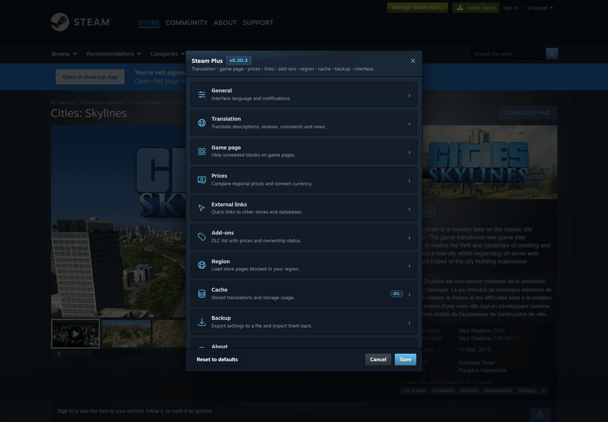

# Steam Plus

[](https://github.com/NemoKing1210/steam-plus/actions/workflows/ci.yml)
[](https://raw.githubusercontent.com/NemoKing1210/steam-plus/main/steam-plus.user.js)
[](https://github.com/NemoKing1210/steam-plus/blob/main/LICENSE)

[English](https://github.com/NemoKing1210/steam-plus/blob/main/README.md) · [Deutsch](https://github.com/NemoKing1210/steam-plus/blob/main/README.de.md) · **Русский** · [Español](https://github.com/NemoKing1210/steam-plus/blob/main/README.es.md) · [Français](https://github.com/NemoKing1210/steam-plus/blob/main/README.fr.md) · [Português (Brasil)](https://github.com/NemoKing1210/steam-plus/blob/main/README.pt-BR.md) · [简体中文](https://github.com/NemoKing1210/steam-plus/blob/main/README.zh-CN.md) · [日本語](https://github.com/NemoKing1210/steam-plus/blob/main/README.ja.md) · [한국어](https://github.com/NemoKing1210/steam-plus/blob/main/README.ko.md) · [Polski](https://github.com/NemoKing1210/steam-plus/blob/main/README.pl.md)

Юзерскрипт, который улучшает Steam Store и Steam Community: полноценная
панель настроек и перевод контента — описаний игр, обзоров, комментариев в
профилях, новостей и руководств — прямо на странице.

> **Статус:** ранняя стадия. Панель настроек (Общие · Перевод · Страница
> игры · Цены · Внешние ссылки · Дополнения · Регион) + перевод контента
> через бесплатный эндпоинт Google (без API-ключа). Планируются новые
> улучшения Steam. Текущая версия и список изменений — в
> [CHANGELOG.md](https://github.com/NemoKing1210/steam-plus/blob/main/CHANGELOG.md).

> `@updateURL` / `@downloadURL` скрипта указывают на ветку `main` в GitHub —
> raw-ссылка ниже всегда ведёт на самую свежую сборку.

## Скриншоты

Настоящий юзерскрипт на живой странице Steam. Для скриншотов выбран
французский язык перевода.



| | |
|---|---|
| <br>**Перевод** — описания, обзоры, комментарии и новости: под оригиналом или с заменой текста | <br>**Региональные цены** — 24 региона магазина, самая низкая цена подсвечена, конвертация по актуальному курсу |
| <br>**Контент для игры (DLC)** — каждый DLC с ценой и датой выхода; статус владения появляется после входа | <br>**Внешние ссылки** — быстрые ссылки на SteamDB, ProtonDB, HowLongToBeat и ваши собственные |
| <br>**Просмотр изображений** — масштабирование, перетаскивание, поворот и просмотр всех изображений дополнений | <br>**Быстрый поиск** — поиск по магазину во всех регионах с любой страницы магазина |

А ещё на страницах игр: скрытие блоков, которые вы не читаете, и загрузка
страниц магазина, заблокированных по региону, через анонимный гостевой
запрос.

## Быстрая установка

1. Установите менеджер юзерскриптов ([Tampermonkey](https://www.tampermonkey.net/),
   [Violentmonkey](https://violentmonkey.github.io/) или
   [ScriptCat](https://scriptcat.org/) — рекомендуется).
2. Установите скрипт с GitHub (raw-ссылка ниже).

**URL установки (GitHub — самая свежая версия):**

```
https://raw.githubusercontent.com/NemoKing1210/steam-plus/main/steam-plus.user.js
```

[](https://raw.githubusercontent.com/NemoKing1210/steam-plus/main/steam-plus.user.js)

### Установка по URL (из панели менеджера)

| Менеджер | Путь |
|---------|------|
| Tampermonkey | Панель управления → **Utilities** → **Install from URL** |
| Violentmonkey | Панель управления → **+** → **Install from URL** |
| Greasemonkey | Меню дополнения → **New User Script** → вставьте raw-ссылку |
| ScriptCat | Установите [расширение](https://scriptcat.org/), затем **Install from URL** с raw-ссылкой GitHub |

При установке из панели менеджера вставьте ссылку на установку с GitHub
(см. выше).

### Ручная установка

1. Откройте собранный [`steam-plus.user.js`](https://github.com/NemoKing1210/steam-plus/blob/main/steam-plus.user.js) в этом репозитории (или выполните `npm run build` после клонирования).
2. Скопируйте всё содержимое файла.
3. В менеджере юзерскриптов создайте новый скрипт и вставьте код.
4. Сохраните и включите скрипт.

## Обновления

Скрипт содержит метаданные `@updateURL` и `@downloadURL`, указывающие на
raw-файл в GitHub. Поддерживаемые менеджеры проверяют обновления
автоматически.

Порядок выпуска для мейнтейнеров: см. [docs/DEVELOPMENT.md § Releasing](https://github.com/NemoKing1210/steam-plus/blob/main/docs/DEVELOPMENT.md#releasing).

## Возможности

**Настройки** (кнопка **Steam Plus** в шапке или меню менеджера юзерскриптов):

- Панель с вкладками — **Общие** · **Перевод** · **Страница игры** · **Цены** · **Внешние ссылки** · **Дополнения** · **Регион** (планируются новые вкладки)
- Steam-нативный тёмный интерфейс; все изменения сохраняются между перезагрузками
- Язык интерфейса: авто (браузер) или один из **10 языков** — English,
  Русский, Deutsch, Español, Français, Português (Brasil), 简体中文, 日本語,
  한국어, Polski

**Перевод** (контент магазина и сообщества):

- **Описания игр** — полное описание на странице игры и фрагменты в списках
- **Обзоры игр** — обзоры в магазине и карточки обзоров в хабе сообщества
- **Комментарии в профилях** — ветки комментариев в профилях, хабах и общих файлах
- **Новости и события** — тела новостей и событий, а также сводки в хабе
- **Руководства** — одна кнопка «Перевести» над руководством переводит всё сразу: заголовок, верхнее описание и каждый раздел (комментарии к руководствам покрываются комментариями в профилях)
- Бесплатный эндпоинт Google по умолчанию — без API-ключа, расширяемый реестр провайдеров
- Перевод **автоматически** по мере появления контента или по кнопке
  **Перевести** у каждого блока
- Показывать перевод **под оригиналом** или **заменять** текст с кнопкой
  возврата к оригиналу
- Целевой язык: авто (язык Steam / браузера) или один из 14 распространённых
  языков
- Переключатели по областям; общий мастер-переключатель

**Страница игры** (страницы игр в магазине):

- Скрывайте блоки, которые не читаете — скриншоты и трейлеры, варианты
  покупки и комплекты, «Об игре», список DLC, системные требования, обзоры
  пользователей, кураторы, события и объявления, информационная панель,
  серия и рекомендации
- Общий переключатель плюс переключатели по блокам; по умолчанию ничего не
  скрыто
- Скрытие на чистом CSS, которое переживает перерисовки Steam и переходы
  между страницами

**Региональные цены** (страницы игр в магазине):

- Сравнение цены игры по 24 регионам магазина Steam прямо на странице — ваша
  цена закреплена сверху, самый дешёвый регион подсвечен, экономия показана
  относительно вашей цены
- Полностью настраивается: мастер-переключатель и автозагрузка, выбор
  регионов, размещение (над вариантами покупки / в боковой панели / под
  описанием), порядок строк по умолчанию с кликабельными заголовками таблицы
  (клик сортирует, повторный клик меняет направление) и переключатели
  отображения элементов (исходная цена, бейдж скидки, экономия, подсветка
  самого дешёвого, строка своей цены)
- Собственные форматированные цены Steam, зелёные бейджи скидок Steam, кэш
  на 1 час с ручным обновлением; для бесплатных игр блок скрывается
  автоматически
- Конвертация по актуальному курсу (ExchangeRate-API + резервный jsDelivr,
  кэш с настраиваемым сроком, статус и ручная очистка в настройках): каждая
  цена автоматически пересчитывается в валюту вашего магазина или в любую
  выбранную, источник курсов указан под блоком

**Внешние ссылки** (страницы игр в магазине):

- Быстрые ссылки на другие магазины и базы данных на странице игры —
  SteamDB, ProtonDB и HowLongToBeat по умолчанию; размещаются над вариантами
  покупки, в боковой панели или под описанием
- Полностью настраиваются: добавляйте свои ссылки с шаблонами URL в стиле
  браузера (`{name}` — название игры, `{appid}` — id Steam), свои favicon,
  переключатели для каждой ссылки, изменение порядка и переключатель
  открытия в новой вкладке

**Контент для игры (DLC)** (страницы игр в магазине):

- Показывает **все DLC игры** с капсулой, датой выхода, ценой и признаком
  того, что дополнение уже есть на аккаунте — счётчик «куплено/всего» в
  заголовке, ссылки на страницы дополнений в каждой строке и порядок
  «сначала некупленные», чтобы пропущенное было сверху
- По умолчанию свёрнут, чтобы не занимать место; разворачивается шевроном в
  заголовке
- Нажмите на изображение дополнения, чтобы открыть **встроенный
  просмотрщик**: вписывание в экран, масштаб (колесо, `+`/`−`, двойной
  клик), перетаскивание, поворот, просмотр всех дополнений с `←`/`→` или
  полосой миниатюр, `Esc` для закрытия; просмотрщик настраивается (полоса
  миниатюр, зацикливание) и доступен с клавиатуры
- Сначала читает собственный список DLC страницы (названия, цены, готовые
  изображения) и запрашивает у Steam только то, чего на странице нет — даты
  выхода и капсулы, которые Steam держит свёрнутыми, подгружаются постепенно
  и кэшируются на сутки, владение — на 30 минут; если отключить
  **Изображения дополнений** и **Даты выхода**, страница, где Steam уже
  отрисовал строки, не потратит ни одного запроса; сброс кэша — во вкладке
  «Дополнения»
- Настраивается: мастер-переключатель, размещение (над вариантами покупки /
  в боковой панели / под описанием), порядок строк, счётчик купленного,
  строки с купленным, цена, изображения и даты выхода

**Обход блокировки** (заблокированные страницы магазина):

- Перезагружает страницы `/app/`, `/bundle/` и `/sub/`, заблокированные с
  сообщением «недоступно в вашем регионе», через анонимный гостевой запрос —
  без cookies аккаунта, с автоматической отправкой cookies языка Steam и
  возрастного фильтра, с необязательным переопределением страны магазина
  (`cc`)
- Вставляет гостевой контент в живой документ — ваша шапка с аккаунтом,
  стили и скрипты остаются нетронутыми; гостевые инициализации (обзоры,
  вкладки системных требований, теги) повторяются, store-острова
  гидрируются на месте, а при структурном несовпадении автоматически
  выполняется полная перезапись документа; перевод, региональные цены,
  внешние ссылки, контент DLC и скрытие блоков применяются к вставленному
  контенту автоматически; авто-режим сразу заменяет ошибку, ручной сначала
  показывает кнопку предложения, при неудаче показывается карточка статуса с
  кнопкой «Повторить»
- Необязательный HTTP-прокси (хост, порт, Basic auth, три режима URL) для
  блокировок по IP — всё во вкладке «Регион»

Под капотом: кэш переводов для каждого провайдера с TTL и обрезкой LRU плюс
очередь запросов с ограничением параллельности — быстро при повторных
визитах и бережно к сервису перевода.

> Для перевода нужно интернет-соединение с провайдером
> (`translate.googleapis.com` для провайдера по умолчанию). Переведённый
> контент кэшируется локально в хранилище юзерскрипта.

## Поддерживаемые страницы

| Сайт | Шаблон URL |
|------|-------------|
| Магазин Steam | `https://store.steampowered.com/*` |
| Сообщество Steam | `https://steamcommunity.com/*` |

## Разработка и участие

- [docs/DEVELOPMENT.md](https://github.com/NemoKing1210/steam-plus/blob/main/docs/DEVELOPMENT.md) — сборка, локальное тестирование, выпуск
- [docs/ARCHITECTURE.md](https://github.com/NemoKing1210/steam-plus/blob/main/docs/ARCHITECTURE.md) — структура модулей, поток данных, контракты расширений
- [CONTRIBUTING.md](https://github.com/NemoKing1210/steam-plus/blob/main/CONTRIBUTING.md) — правила PR и соглашения
- [SECURITY.md](https://github.com/NemoKing1210/steam-plus/blob/main/SECURITY.md) — как сообщить об уязвимости
- [AGENTS.md](https://github.com/NemoKing1210/steam-plus/blob/main/AGENTS.md) — заметки по архитектуре для ИИ-агентов

```bash
npm install
npm run dev      # Vite serve — установить сгенерированный "dev:" юзерскрипт
npm run build    # Production → dist/ + копирование в корень репозитория
npm run ci       # те же проверки, что и в GitHub Actions
```

Требуется Node.js 22 (см. `.nvmrc`).

## Принадлежность

Проект **не связан** с Valve или Steam. Это независимый юзерскрипт
сообщества.

## Лицензия

[MIT](https://github.com/NemoKing1210/steam-plus/blob/main/LICENSE) — Copyright (c) 2026 NemoKing1210
